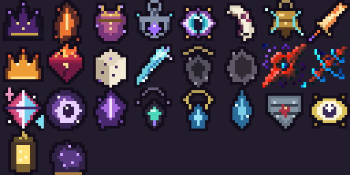
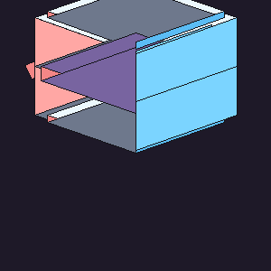

# 梦魇之核 · Nightmare Core

一个为 **Minecraft 1.20.1 Forge** 整合包定制的诅咒饰品模组。

玩家将「梦魇之核」佩戴在 Curios 的**梦魇槽**中，换取 3 个**赐福槽**，同时承受**七重诅咒**。核心不再修改任何属性；赐福分为两类：七件**压制赐福**各压制一项诅咒，多件由梦魇专属材料制作的**属性/功能赐福**提供额外能力，但**不压制诅咒**。三个槽位必须在这两类之间取舍。

> 设计核心：**梦核本身不加不减任何属性，只施加七重诅咒。** 玩家可以用最多三件赐福压制三项诅咒，或换取属性/功能，其余诅咒继续生效。

> **0.8.4**：加入三件强力数值/机制赐福；五种梦魇改为独立行为（远程/高血/高移速/光环/毒伤）；未佩戴梦核时无法使用本模组工具和饰品（余烬之刃除外）。




## 环境

| 项目 | 版本 |
| --- | --- |
| Minecraft | 1.20.1 |
| Forge | 47.4.9（建议 47.4.x） |
| Curios | 5.14.1+1.20.1（必需） |
| Java | 17 |

## 安装

1. 将 `nightmare_core-1.20.1-0.8.4.jar` 放入整合包的 `mods/`。
2. 确保 `curios-forge-5.14.1+1.20.1.jar` 或更高兼容版本也在 `mods/`。
3. 启动游戏。首次启动会生成 `config/nightmare_core-common.toml`。

Curios 是硬前置，未安装时游戏会在加载阶段提示缺少依赖。模组没有把 Curios 打包进自身 jar。

## 核心循环

1. 玩家**第一次使用床**时，在床边掉落一枚「梦魇之核」。梦核不再有合成配方。
2. 在 Curios 界面中把核心放入梦魇槽。
3. 核心立即展开 3 个赐福槽，并施加七重诅咒；它不修改任何属性。
4. 击杀生物或破坏方块，按幸运等级与「猎梦之眼」加成判定梦魇碎片。
5. 用碎片制作赐福饰品与特殊道具。
6. 生存模式无法主动取下核心；需要先合成并使用有耐久的「余烬之刃」切断联系。

## 梦魇之核

- 装备槽：梦魇槽（`nightmare`，1 格）。
- 佩戴时提供：赐福槽（`blessing`）+3（基础为 0 格，因此只有佩戴核心才会出现）。
- **不修改任何属性**：没有最大生命值、攻击伤害、护甲、韧性、移速或攻速修正。
- 只施加七重诅咒；诅咒会实时判断当前佩戴的赐福。
- 工具提示：
  - 默认显示七条诅咒名称；
  - 已被对应赐福压制时，名称后显示 **（已被压制）**；
  - 按住 **Shift** 显示每条诅咒的简述。
- 生存模式**无法主动取下**梦魇之核；Curios 的取出/替换会被拒绝。唯一例外是使用有耐久的「余烬之刃」。
- 创造模式可作为管理员逃逸方式直接取下。
- 默认死亡时保留（`keepCoreOnDeath = true`）。这是进度钥匙，避免整合包中因意外死亡导致循环中断。
- 佩戴和取下时会有动作栏提示与灵魂粒子；佩戴期间偶尔出现梦魇粒子。

### 首次获取

- 梦魇之核**没有合成配方**，也不再通过配方书解锁。
- 默认配置下，玩家第一次使用床时会在床边掉落 1 枚梦核。
- 每个玩家只触发一次，通过持久化标记记录；如果玩家已经持有梦核，则只记录标记，不会重复掉落。
- 可在配置中关闭：`nightmare_core.giveCoreOnFirstSleep = false`。关闭后不会自动给予，也没有替代配方。
- 首次睡觉本身不会立即触发梦魇，因为此时梦核还在地上、尚未佩戴。

## 七重诅咒

七重诅咒在核心佩戴期间同时生效，取下核心后全部停止。**每件赐福可以压制一项诅咒**，但只有三个赐福槽，因此最多同时压制三项。

> 以下数值为默认值。第 2、3、4、6、7 项诅咒可在 `config/nightmare_core-common.toml` 的 `curses.*` 中调整；第 1、5 项没有额外配置。

| # | 诅咒 | 效果 | 压制赐福 |
| ---: | --- | --- | --- |
| 1 | 睡眠梦魇 | 上床时按概率生成五种梦魇之一 | 守夜甲壳 |
| 2 | 生命回复上限 | 当前生命最多恢复到上限的 10% + 10% × min(8, 等级/20)，最高 90% | 余烬心室 |
| 3 | 伤害衰减 | 对他人伤害 ≤5 点时无效；>5 点时减少 20% | 裂梦之牙 |
| 4 | 出生点限制 | 只有 16 格内存在敌对生物时才能保存出生点 | 坚岩坠饰 |
| 5 | 清醒时双倍受伤 | 不处于睡眠状态时，受到的所有伤害 ×2 | 疾影羽饰 |
| 6 | 黑暗侵蚀 | 亮度 <3 持续 5 秒后，每秒受到最大生命值 20%（向上取整）的伤害，不致死 | 猎梦之眼 |
| 7 | 精神失常 | 连续 7 天不入睡后获得「精神失常」 | 回响铃 |

### 生命回复上限

- 上限比例：`10% + 10% × min(8, floor(经验等级 / 20))`，最高 **90%**。
- 等级 0：10%；等级 20：20%；……等级 160 及以上：90%。
- 按**当前最大生命值**计算。核心不再改变最大生命值，因此 0 级上限为基础 20 的 10%，即 2 点生命。
- 生命值超过上限时会立即压回；治疗事件也会被截断，不能靠药水绕过。
- 佩戴余烬心室后该诅咒失效；余烬心室不再提供最大生命值加成。

### 伤害衰减

- 只影响玩家**对他人**造成的伤害；自伤、黑暗侵蚀和诅咒伤害不受影响。
- 原始伤害 ≤5：完全无效。
- 原始伤害 >5：最终伤害为原始的 **80%**。
- 佩戴裂梦之牙后该诅咒失效。

### 出生点限制

- 通过床、重生锚保存出生点时，检查目标位置周围 16 格内是否有 `Enemy`；没有则取消并提示。
- 管理员 `/spawnpoint` 等 forced 设置会绕过限制。
- 佩戴坚岩坠饰后该诅咒失效。

### 清醒时双倍受伤

- 玩家醒着时受到的所有伤害 ×2；躺在床上的状态不受影响。
- 佩戴疾影羽饰后该诅咒失效。

### 黑暗侵蚀

- 使用世界环境亮度（天空光 + 方块光）判断，亮度 **<3** 开始计时。
- 连续 5 秒后，每秒受到 `ceil(最大生命值 × 20%)` 的伤害。
- 伤害**不会致死**：至少保留 1 点生命值。
- 离开黑暗、佩戴猎梦之眼或取下核心会重置计时。

### 精神失常

- 从进入床铺开始计时；连续 **7 个游戏日（168000 tick）** 未入睡后获得永久「精神失常」效果。
- 移动：客户端每秒有 25% 概率将移动输入反向 1 秒。
- 攻击：20% 概率对自身造成该次攻击 50% 的伤害。
- 入睡或佩戴回响铃会清除效果并重置计时。

## 梦魇碎片

只有**核心确实位于梦魇槽**时才可能触发。判定对象是“每次击杀 / 每个被破坏的方块”，成功一次掉落 1–3 个（可配置）。

```
最终概率 = 5% + 5% × floor(幸运属性等级) + 5%（佩戴猎梦之眼时）
```

- 基础概率 5%，每级幸运 +5%，上限 100%。
- 「猎梦之眼」额外提供 5% 加算概率；同种赐福只能佩戴一件，因此最多生效一次。
- **不受抢夺（Looting）影响。**
- **不受时运（Fortune）影响。**
- 代码不读取 `Looting`、`Fortune` 或工具附魔。
- 幸运属性来自原版 `minecraft:generic.luck`（幸运药水等）；负幸运可以降低概率，最低为 0。
- 生存模式、非旁观、非假人、非创造模式才触发。
- 击杀需要由玩家造成或玩家发射的弹射物造成；宠物击杀不计数。
- 默认允许被动生物，默认禁止 PvP 击杀（均可配置）。
- 被取消的方块破坏事件不会触发；黑名单标签见下文。

## 赐福饰品

赐福分为两类，都只能放入赐福槽：

- **压制赐福**：不提供属性，只压制一项诅咒。
- **属性/功能赐福**：不压制诅咒，提供属性与一个功能性效果。

**同种赐福只能佩戴一件**：正常放入时会被 `canEquip` 拒绝；通过命令等方式塞入的重复项，会在最多 1 秒内被服务器强制弹出并退回背包。

### 压制赐福

| 赐福 | 压制诅咒 | 合成 |
| --- | --- | --- |
| 余烬心室 | 生命回复上限 | 4 碎片 + 闪烁的西瓜片 |
| 裂梦之牙 | 伤害衰减 | 4 碎片 + 铁剑 |
| 守夜甲壳 | 睡眠梦魇 | 4 碎片 + 盾牌 |
| 坚岩坠饰 | 出生点限制 | 4 碎片 + 黑曜石 |
| 疾影羽饰 | 清醒双倍受伤 | 4 碎片 + 羽毛 |
| 回响铃 | 精神失常 | 4 碎片 + 紫水晶碎片 |
| 猎梦之眼 | 黑暗侵蚀 | 4 碎片 + 望远镜 |

### 属性/功能赐福

| 赐福 | 属性 | 功能 | 合成 |
| --- | --- | --- | --- |
| 余烬王冠 | +2 护甲，+0.5 护甲韧性 | 抗火 | 4 碎片 + 灰烬余烬 |
| 潮汐吊坠 | +4 最大生命值 | 水下呼吸 | 4 碎片 + 潮汐之泪 |
| 裂隙之瞳 | +0.01 移动速度（约 +10%） | 夜视 | 4 碎片 + 裂隙碎片 |
| 守夜提灯 | +2 护甲 | 抗性提升 I | 4 碎片 + 守夜之眼 |
| 空壳护符 | +2 攻击伤害，+0.5 击退抗性 | 无 | 4 碎片 + 空壳残片 |
| 深渊王冠 | +6 护甲，+3 护甲韧性，+8 最大生命值 | 抗性提升 I | 4 碎片 + 2 灰烬余烬 + 2 潮汐之泪 + 下界之星 |
| 虚空护手 | +5 攻击伤害，+0.8 攻击速度 | 力量 I | 4 碎片 + 2 裂隙碎片 + 2 空壳残片 + 下界之星 |
| 命运骰子 | +2 幸运，+0.01 移动速度 | 20% 概率完全闪避伤害，触发后 5 秒冷却 | 4 碎片 + 2 守夜之眼 + 2 空壳残片 + 下界之星 |

- 压制赐福不改变面板属性；属性/功能赐福不压制任何诅咒。
- 三个赐福槽可以在两类之间自由混搭。
- 猎梦之眼仍提供 **+5% 梦魇碎片概率**。
- 深渊王冠、虚空护手、命运骰子属于后期强力饰品，材料需要击杀对应梦魇并消耗下界之星。

## 三槽取舍

不再存在“三件赐福是否强于核心”的属性审计。现在的平衡点是七项诅咒、八个专属赐福和三个槽位：

- 想安全度过夜晚：带守夜甲壳。
- 想正常回血：带余烬心室。
- 想正常打怪：带裂梦之牙。
- 想保存出生点：带坚岩坠饰。
- 想避免清醒时被秒：带疾影羽饰。
- 想下矿/夜间探索：带猎梦之眼。
- 想长期不睡：带回响铃。
- 想补属性/功能：带余烬王冠、潮汐吊坠、裂隙之瞳、守夜提灯、空壳护符、深渊王冠、虚空护手或命运骰子，但对应诅咒不会因此失效。

## 梦核依赖

未佩戴梦魇之核时：

- 所有赐福饰品无法装备（包括新增强力赐福）。
- 梦魇棱镜、归梦锚等本模组工具无法使用。
- 本模组攻击性内容无法使用。

**余烬之刃除外**：即使没有佩戴梦核，也可以正常作为武器/物品使用。梦核本身也可以正常拾取和装备。

玩家只能从中选三项，其余诅咒必须用玩法手段承受。

## 特殊道具

### 梦魇棱镜

- 揭示周围 24 格内所有敌对生物（实现为 `Enemy`），使其发光 20 秒。
- 成功发现目标后冷却 60 秒；附近没有目标时只冷却 5 秒。
- 不消耗耐久，可重复使用。
- 合成：2 梦魇碎片 + 2 紫水晶碎片 + 1 玻璃。

### 归梦锚

- 潜行使用：绑定当前位置（维度 + 坐标 + 朝向）。
- 普通使用：回到绑定位置。
- 只能在同一维度内生效；落点被阻挡时会拒绝传送。
- 每次传送消耗 1 点耐久（共 8 点），并有 10 秒冷却。
- 合成：3 梦魇碎片 + 1 指南针 + 1 黑曜石。

### 余烬之刃

- 生存模式解除梦魇之核的**唯一**手段。
- 对梦魇之核使用：直接把核心从梦魇槽中切下并放回背包；背包满时掉落在脚下。
- 每次成功使用消耗 **64 点耐久**，并对使用者造成 **6 点魔法伤害**；共 512 点耐久，约可切 8 次。没有核心时不消耗。
- 本身可作为武器：基础总伤害 **8**（略强于钻石剑的 7），攻击速度 1.6，介于钻石与下界合金剑之间；可附魔。
- 合成：3 梦魇碎片 + 1 铁剑 + 1 烈焰粉。

### 梦魇遭遇

佩戴梦魇之核上床睡觉时，有 **10%** 概率在床周围 5–10 格内生成一只梦魇。只在非和平难度生成，每次上床判定一次；佩戴**守夜甲壳**时不会生成。

五种梦魇已分别注册为独立实体：

| 实体 ID | 名称 | 机制 | 生成权重 | 当前模型 |
| --- | --- | --- | ---: | --- |
| `rift_nightmare` | 梦魇之眸 | 距离 >4 格时射箭，近距离转为近战 | 30% | 自定义「梦魇之眸」模型 |
| `ashen_nightmare` | 梦魇之颅 | 近战，基础生命 ×1.6，伤害 ×0.7 | 25% | 原版僵尸（占位） |
| `vigil_nightmare` | 梦魇之影 | 近战，移速 ×1.5；无附魔武器伤害 -40% | 20% | 原版僵尸（占位） |
| `hollow_nightmare` | 梦魇之手 | 近战，攻击附加中毒或凋灵 | 20% | 原版僵尸（占位） |
| `tidal_nightmare` | 梦魇之心 | 无法移动；存活时 16 格内其他梦魇免疫伤害 | 5% | 原版僵尸（占位） |

基础属性仍然允许通过 `nightmares.*` 统一配置；默认值与原版僵尸一致：

- 最大生命值：**20**。
- 攻击伤害：简单/普通/困难均为 **3**。
- 移动速度属性：**0.23**。
- 跟随范围：**35**。
- 护甲：**2**。
- 上述生命/伤害/移速倍率会在基础配置之上应用。
- 永久存在、会主动锁定入睡的玩家。
- 击败后清除原版僵尸掉落，**必定掉落 1–2 个梦魇碎片 + 1–2 个该类型专属材料**，有 **5%** 概率直接掉落对应的属性/功能赐福，并有 **10%** 概率额外掉落 1 个祝福袋。
- 梦魇不会触发普通碎片掉落判定，避免双倍掉落。

### 自定义模型

**梦魇之眸**（`rift_nightmare`）已套用 `梦魇之眸.bbmodel` 转换出的自定义几何模型；其余四种暂时继续使用原版僵尸模型占位。



- 模型纹理：`assets/nightmare_core/textures/entity/nightmare_eye.png`。
- 模型类：`NightmareEyeModel`，渲染器：`NightmareEyeRenderer`。
- 已绑定动画：待机、移动、攻击、受伤、死亡；使用原 `动画.java` 的关键帧节奏手动实现，不额外依赖 GeckoLib。
- “远程/近战模型切换”目前先实现为远程射击与近战行为切换；独立的近战形态模型需要后续模型文件。
- 其余四种实体类型已经分开注册，后续可以逐个替换模型。

### 刷怪蛋

五种梦魇各自有刷怪蛋，可在创造模式物品栏或 `/give` 获取：

| 刷怪蛋 | 生成实体 |
| --- | --- |
| 梦魇之眸刷怪蛋 | `rift_nightmare` |
| 梦魇之颅刷怪蛋 | `ashen_nightmare` |
| 梦魇之影刷怪蛋 | `vigil_nightmare` |
| 梦魇之手刷怪蛋 | `hollow_nightmare` |
| 梦魇之心刷怪蛋 | `tidal_nightmare` |

### 阳光灼烧

- 梦魇暴露在阳光下（白天 + 能看到天空）时，每秒损失 **30% 最大生命值**。
- 这是魔法伤害，**不受抗火影响**；默认为 30%，可通过配置调整。
- 伤害可以致死。梦魇在阴影、夜晚或室内不会受到阳光伤害。

### 梦魇专属材料

| 梦魇 | 专属材料 | 对应赐福 |
| --- | --- | --- |
| 梦魇之颅 | 灰烬余烬 | 余烬王冠 |
| 梦魇之心 | 潮汐之泪 | 潮汐吊坠 |
| 梦魇之眸 | 裂隙碎片 | 裂隙之瞳 |
| 梦魇之影 | 守夜之眼 | 守夜提灯 |
| 梦魇之手 | 空壳残片 | 空壳护符 |

材料只由对应梦魇掉落，每只必掉 1–2 个；另有 5% 概率直接掉落对应赐福。

### 祝福袋

- 右键使用，消耗 1 个，随机获得六种基础**压制赐福**之一（不含猎梦之眼）。
- 只由梦魇掉落，无合成配方。
- 背包满时奖励会掉落在脚下。

## 获取方式

### 梦魇之核

**无合成配方。** 默认在玩家第一次使用床时于床边掉落；可通过 `nightmare_core.giveCoreOnFirstSleep` 关闭。

### 赐福与特殊道具

所有梦魇碎片配方会在玩家获得首个梦魇碎片后通过配方书 Advancement 解锁，JEI/EMI 也会直接显示。属性/功能赐福还需要对应梦魇掉落的专属材料。

## 配置

路径：`config/nightmare_core-common.toml`

| 配置项 | 默认 | 说明 |
| --- | ---: | --- |
| `fragment_drops.enableFragmentDrops` | true | 碎片掉落总开关 |
| `fragment_drops.baseChancePercent` | 5.0 | 基础概率（百分比） |
| `fragment_drops.chancePerLuckLevel` | 5.0 | 每级幸运增加的概率 |
| `fragment_drops.charmBonusPercent` | 5.0 | 猎梦之眼额外增加的概率 |
| `fragment_drops.minFragments` | 1 | 单次成功最少数量 |
| `fragment_drops.maxFragments` | 3 | 单次成功最多数量 |
| `fragment_drops.dropFromMobs` | true | 击杀掉落开关 |
| `fragment_drops.dropFromBlocks` | true | 破坏方块掉落开关 |
| `fragment_drops.allowPassiveMobs` | true | 被动生物是否计数 |
| `fragment_drops.allowPlayerKills` | false | PvP 击杀是否计数 |
| `nightmare_core.keepCoreOnDeath` | true | 死亡时保留核心 |
| `nightmare_core.giveCoreOnFirstSleep` | true | 第一次睡觉时在床边给予梦核 |
| `nightmares.sleepSpawnChancePercent` | 10.0 | 佩戴核心入睡时生成梦魇的概率 |
| `nightmares.blessingBagChancePercent` | 10.0 | 梦魇掉落祝福袋的概率 |
| `nightmares.health` | 20.0 | 梦魇最大生命值（默认僵尸） |
| `nightmares.attackDamageEasy` | 3.0 | 简单难度攻击伤害（默认僵尸） |
| `nightmares.attackDamageNormal` | 3.0 | 普通难度攻击伤害（默认僵尸） |
| `nightmares.attackDamageHard` | 3.0 | 困难难度攻击伤害（默认僵尸） |
| `nightmares.movementSpeed` | 0.23 | 移动速度属性（默认僵尸） |
| `nightmares.followRange` | 35.0 | 跟随范围（默认僵尸） |
| `nightmares.armor` | 2.0 | 护甲（默认僵尸） |
| `nightmares.sunlightDamagePercent` | 30.0 | 阳光每秒损失的最大生命值百分比 |
| `curses.health_cap.defaultPercent` | 10.0 | 第2诅咒：0 级生命回复上限（%） |
| `curses.health_cap.levelsPerIncrement` | 20 | 第2诅咒：每多少级提升一次 |
| `curses.health_cap.incrementPercent` | 10.0 | 第2诅咒：每次提升的上限（%） |
| `curses.health_cap.maxPercent` | 90.0 | 第2诅咒：最高回复上限（%） |
| `curses.damage.threshold` | 5.0 | 第3诅咒：伤害阈值 |
| `curses.damage.reductionPercent` | 20.0 | 第3诅咒：超过阈值后的削减比例（%） |
| `curses.spawn_point.hostileRadius` | 16.0 | 第4诅咒：敌对生物检测范围（格） |
| `curses.darkness.triggerSeconds` | 5.0 | 第6诅咒：低亮度触发时间（秒） |
| `curses.darkness.damagePercentPerSecond` | 20.0 | 第6诅咒：触发后每秒伤害（最大生命值%） |
| `curses.insanity.days` | 7.0 | 第7诅咒：多少天不睡触发精神失常 |

1.1.0 起，TOML 内的描述均使用中文；同时在 `zh_cn.json` / `en_us.json` 中提供了 `nightmare_core.config.*` 翻译键，供配置界面类模组读取。

如果是从旧版本升级，Forge 不一定会重写已有 TOML 的注释。想看到完整中文描述，请先备份并删除旧的 `config/nightmare_core-common.toml`，让服务器重新生成；这会恢复默认值。

修改配置后重启服务器/客户端。概率和数量会在每次判定时读取。

## 数据包定制

### 黑名单标签

- 方块：`data/<你的命名空间>/tags/blocks/no_fragment_drops.json`，标签 ID 为 `nightmare_core:no_fragment_drops`。
- 实体：`data/<你的命名空间>/tags/entity_types/no_fragment_drops.json`，标签 ID 为 `nightmare_core:no_fragment_drops`。

示例：

```json
{
  "replace": false,
  "values": [
    "minecraft:spawner",
    "minecraft:reinforced_deepslate"
  ]
}
```

实体标签默认包含 `minecraft:armor_stand`。

### Curios 槽位标签

- 梦魇槽位物品标签：`curios:nightmare`。
- 赐福槽位物品标签：`curios:blessing`。

如果要让整合包自制的饰品也能放入赐福槽，把物品加入 `curios:blessing` 标签即可。注意：该物品不会自动获得本模组的赐福数值审计保护。

### 玩家槽位绑定

槽位类型本身不会自动出现在玩家身上。本模组通过 `data/nightmare_core/curios/entities/player.json` 把 `nightmare` 和 `blessing` 绑定到 `minecraft:player`；如果数据包使用 `replace: true` 覆盖玩家实体槽位，需要手动保留这两个槽位。

### 配方覆盖

直接在自己的数据包中使用相同路径覆盖 `data/nightmare_core/recipes/*.json`。如果不想让玩家通过配方书看到，可以同时删除对应的 `data/nightmare_core/advancements/recipes/*.json`。

## 从源码构建

```powershell
# 改成你本机的 JDK 17 路径
$env:JAVA_HOME = 'D:\java\java17'
.\gradlew.bat build
```

产物：`build/libs/nightmare_core-1.20.1-0.8.4.jar`。

仓库中的 `dist/` 已放置构建完成的 jar 和 `SHA256SUMS.txt`，可以直接分发：

```
d21c36acc4775b4df34d6685045e953d99c832da1f76616675f899864bc1fbc9  nightmare_core-1.20.1-0.8.4.jar
```

`libs/curios-forge-5.14.1+1.20.1.jar` 仅作为本地编译/测试依赖，不会被放进模组 jar，也不会随模组分发。Curios 本身仍需由整合包单独安装。

## 验证记录

- 在 **Forge 47.4.16** 专用服务器 + **Curios 5.14.1** 上完成生产环境加载测试。
- Curios 输出 `Loaded 12 curio slots`，`/curios list` 确认槽位类型存在：
  - `nightmare - nightmare_core`
  - `blessing - nightmare_core`
- **玩家实体实际槽位**：`CuriosApi.getPlayerSlots(overworld)` 输出 `[nightmare, blessing]`，确认不是只有全局槽位类型，而是玩家真的拥有这两个槽位。
- **七重诅咒测试**：生命上限在 0 级为 `2.0`（10%×20），180 级为 `18.0`（90%×20）；装备余烬心室后不被压回（`20.0`）。
- **伤害规则测试**：4 点攻击被取消（`lowCanceled=true`）；10 点攻击变为 8；清醒时 5 点受伤变为 10；装备疾影羽饰后保持 5。
- **精神失常测试**：把最后入睡时间回拨后获得效果；装备回响铃后效果被清除；入睡后效果被清除。
- **梦魇实体测试**：默认配置下生命 `20`、简单难度伤害 `3`、移动速度属性 `0.23`、护甲 `2`，与僵尸一致。
- **梦魇专属材料测试**：五种实体分别映射到灰烬余烬、潮汐之泪、裂隙碎片、守夜之眼、空壳残片。
- **属性/功能赐福测试**：余烬王冠提供 +2 护甲、+0.5 护甲韧性，并正确施加抗火；不压制任何诅咒。
- **阳光测试**：白天暴露在天空下时，20 生命的梦魇按每秒 6 点扣血：20 → 14 → 8 → 2 → 死亡；可通过配置调整。
- **刷怪蛋**：五种梦魇刷怪蛋已注册并通过服务端加载；物品模型使用原版 `template_spawn_egg`。
- **模型动画**：梦魇之眸已绑定待机、移动、攻击、受伤、死亡五组动画，模型层 `nightmare_eye` 正常注册。
- **掉落修复测试**：用刷怪蛋/召唤生成的梦魇被击杀后掉落 2 个梦魇碎片 + 2 个专属材料，掉落事件正常。
- **梦核依赖测试**：未佩戴梦核时祝福 `canEquip=false`，佩戴后为 `true`。
- **变体测试**：梦魇之颅 32 生命/2.1 伤害；梦魇之影移速 0.345；梦魇之心移速 0；无附魔铁剑对梦魇之影 10 点伤害降至 6；梦魇之心光环取消周围梦魇伤害。
- **首次睡觉测试**：首次触发掉落 1 枚梦核（`first=1`），第二次不再掉落（`second=1`），持久化标记为 `true`。
- **配方检查**：`nightmare_core` 的配方与配方 Advancement 已从数据包中移除，当前共 **18 个配方**。
- **诅咒配置测试**：服务端生成 `curses.*` 全部 10 个配置项及中文注释，默认值与代码读取一致。
- 0.8.4 打包了 **18 个配方**和对应的 18 个解锁 Advancement；服务器正常加载，无数据包解析错误。
- 配置文件已实际生成中文 TOML 注释；逐字节检查为合法 UTF-8。
- **同种赐福唯一性测试**：临时假人放入余烬心室后，再尝试放入第二件同名饰品返回 `duplicateBlocked=true`，放入不同赐福返回 `differentAllowed=true`，且核心展开的赐福槽数量为 3。
- **核心锁定与余烬之刃测试**：生存模式下 `survivalLocked=true`；余烬之刃使用后 `coreAfterBlade=false`、核心回到背包 `coreInInventory=1`、耐久消耗 `bladeDamage=64`。
- **睡眠梦魇测试**：调试强制生成成功，默认生命 `20`、简单难度伤害 `3`、移动速度属性 `0.23`。
- **祝福袋测试**：使用后获得 1 件随机基础赐福（`bagBlessingCount=1`）。
- **无属性审计**：启动日志为 `Curses-only balance audit passed: 7 curses, 3 blessing suppression slots.`，梦核与赐福均不再注册属性修正。
- 服务器正常进入 `Done`，无模组加载错误或数据包解析错误。

## 开发/运行说明

`gradlew runServer` 使用的是 ForgeGradle 开发环境；Curios 的发布 jar 带有面向生产环境的 Mixin refmap，直接放进开发运行环境可能触发 `MixinInventory` 的字段映射错误。这不是本模组的问题，也不影响生产服务器。

推荐用真实 Forge 服务端验证：把构建出的 jar 和 Curios 放进同一个 `mods/`，启动即可。上面的验证记录就是这样完成的。

## 素材说明

- `梦魇核心.png`：核心物品纹理。
- `梦魇残片.png`：碎片物品纹理。
- `nightmare.png`：梦魇槽空槽图标。
- `赐福槽.png`：赐福槽空槽图标。
- `猎梦之眼`：新增图标由 `tools/generate_assets.py` 生成。
- `余烬之刃`：新增图标由 `tools/generate_assets.py` 生成。
- `祝福袋`：新增图标由 `tools/generate_assets.py` 生成。
- `灰烬余烬 / 潮汐之泪 / 裂隙碎片 / 守夜之眼 / 空壳残片`：五种梦魇专属材料图标。
- `余烬王冠 / 潮汐吊坠 / 裂隙之瞳 / 守夜提灯 / 空壳护符`：五件基础属性/功能赐福图标。
- `深渊王冠 / 虚空护手 / 命运骰子`：三件强力数值/机制赐福图标。
- `梦魇`：暂时直接使用原版僵尸模型，五种实体类型已经分开注册，后续可分别替换模型。
- `精神失常`：状态效果图标位于 `assets/nightmare_core/textures/mob_effect/insanity.png`。

四张原始图在 `design/source/` 中保留；空槽图标为适配 Curios 深色界面做了轻微提亮，其余物品图标由 `tools/generate_assets.py` 生成。重新生成：

```powershell
python tools/generate_assets.py
python tools/generate_data.py
```

## 已知边界

- 依赖 Curios 的槽位与饰品判定；没有 Curios 时无法运行。
- 只对真实 `ServerPlayer` 生效；假人、创造模式、旁观模式不参与掉落。
- 方块掉落以 `BlockEvent.BreakEvent` 为准，被保护插件取消的破坏不会掉落。
- 如果服务器安装了改变 `Attributes.LUCK` 的模组，概率会按最终幸运属性计算；这是有意的，不属于抢夺/时运。
- 取核心会使赐福槽缩回 0 格，Curios 会把已装备的赐福弹出；建议在安全位置使用余烬之刃。
- 同种赐福不可重复；通过命令强行放入的重复项会在最多 1 秒内被服务器退回。
- 生存模式无法通过 Curios 界面取下核心；创造模式保留管理员取下途径。
- 睡眠梦魇使用五种独立自定义实体类型，但暂时套用原版僵尸模型；其他模组对僵尸的强化/削弱可能同时生效。
- 梦魇默认属性与原版僵尸一致，并全部可在配置中修改；旧的 200 生命/12-18 伤害/0.8 格每秒不再是默认值。
- 梦魇之眸使用自定义「梦魇之眸」模型与动画，其余四种仍为僵尸占位模型。
- 梦魇刷怪蛋支持五种实体，可在创造物品栏或 `/give` 中获取。
- 七重诅咒与三赐福槽的取舍是刻意设计的；祝福袋只给随机基础赐福，不保证能拿到想压制的诅咒对应件。
- 生命回复上限按当前最大生命值计算；梦核不再改变最大生命值，0 级上限为基础 20 的 10%（2 点），余烬心室是主要解法。
- 五种梦魇的行为、生命/伤害/移速倍率与生成权重均不同；后续可为各自替换模型。
- 梦核与赐福都不再注册属性修正；旧版“80% 属性上限”机制已完全移除。
- 梦核提示中的「（已被压制）」根据本地玩家当前佩戴的赐福实时计算；在 JEI 等没有玩家上下文的界面中只显示诅咒名称。
- 七件压制赐福只负责压制诅咒；八件属性/功能赐福只提供属性与效果，不压制诅咒。
- 五种梦魇各自掉落对应专属材料，每只必掉 1–2 个；材料只用于对应赐福配方。
